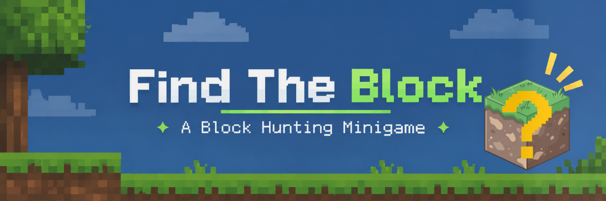
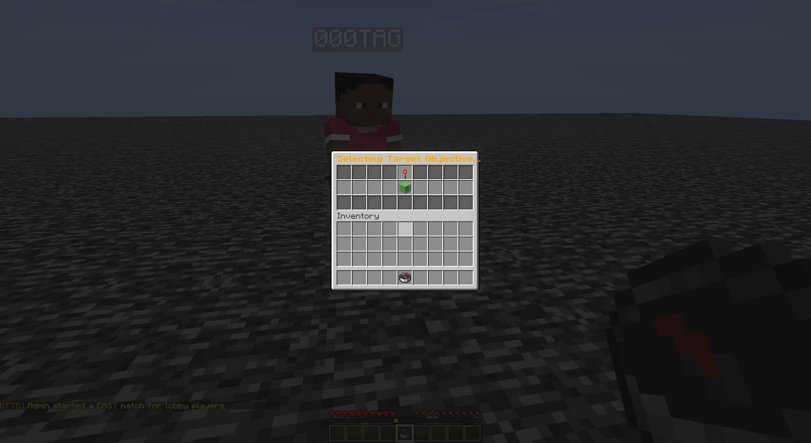
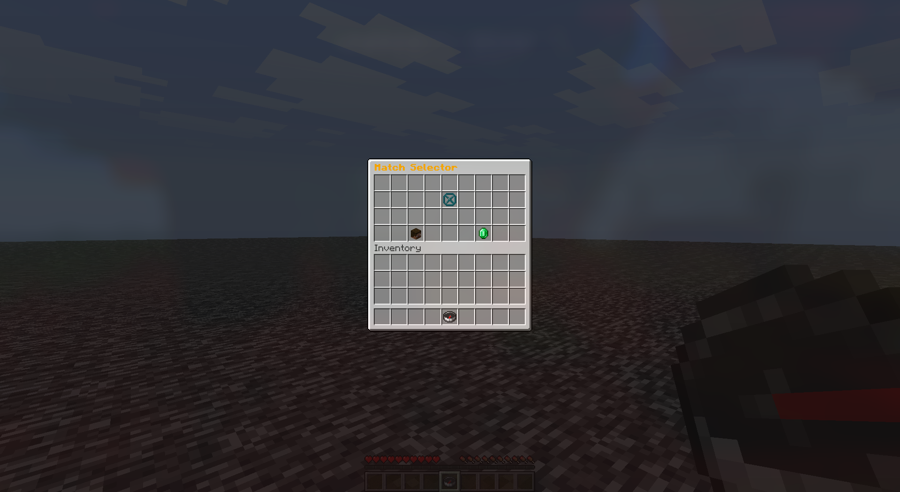
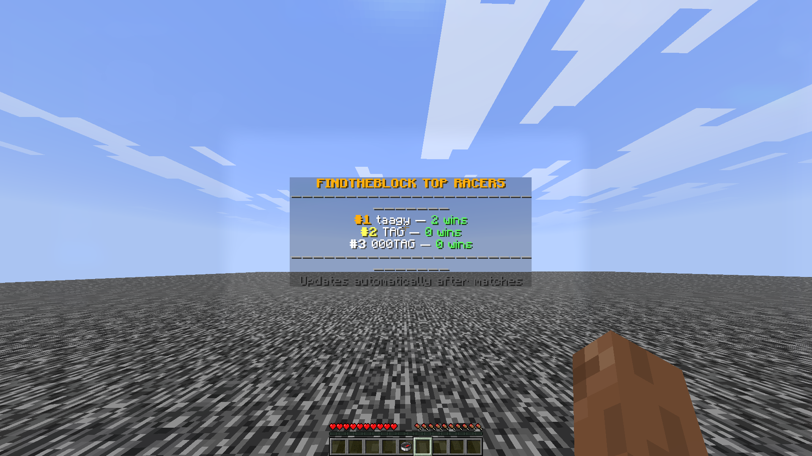

  

## Features

- **Fresh worlds every match** -- each game generates a new survival world with full Overworld and Nether access
- **Party system** -- group up with friends before starting a match
- **Leaderboard** -- track top players across matches
- **Starter kit** -- iron tools and a silk touch pickaxe to get going
- **20-minute buffs** -- survival buffs kick in after 20 minutes to keep things moving
- **PlaceholderAPI support** -- plug stats into scoreboards and other plugins
- **Game-Selectpor Compass** -- players are provided a compass to select gamemode. 

## Screenshots

| Block Selector | Match & Party Hub |
| :---: | :---: |
|  |  |
| In-Game UI | Leaderboard |
|  |  |

## Commands

Game-Commands

  
| Command | Description |
|---------|-------------|
| `/findtheblock`, `/ftb` | Main plugin command |
| `/start [tier]` | Starts party ready check (or lobby-wide match if admin) |
| `/join` | Joins an ongoing match as a late racer |
| `/leave` | Leaves your active match or party and returns to lobby |
| `/spectate`, `/spec` | Enters match world as a spectator |
| `/menu`, `/selector` | Opens the Match Selector and Party Hub GUI |
| `/recipe` | Opens the crafting recipe / guide for the current target block |
| `/top` | Opens the interactive leaderboard menu |

Party Commands

| Command | Description |
|---------|-------------|
| `/party`, `/p` | Opens Party Management or Party Finder |
| `/party finder` | Opens the public Party Finder GUI |
| `/party create [public|private]` | Creates a new party (public by default) |
| `/party invite <player>` | Invites a player to your party |
| `/party accept` / `/party deny` | Accepts or declines a party invitation |
| `/party leave` / `/party disband` | Leaves or disbands your current party |
| `/party public` / `/party private` | Toggles party visibility in Party Finder |
| `/party start [tier]` | Starts the 20-second ready check for party members |

Admin Commands

| Command | Description |
|---------|-------------|
| `/ftb startall [tier]` | Starts a match for all players in the lobby |
| `/ftb stop` / `/ftb stopall` | Cancels all active matches and returns players to lobby |
| `/ftb leaderboard spawn [wins|time]` | Spawns a floating in-world leaderboard at your location |
| `/ftb leaderboard remove` | Removes the nearest floating leaderboard within 10 blocks |
| `/ftb reload` | Reloads the config and updates floating leaderboards |

